## Tarih

Paranın icadından bugüne bitcoinlere varan serüvene bir gözatmak bazı
şeyleri yeniden hatırlamak istedim. Sonrasında da bugünün gündemi olan
bitcoin ve kriptoparaları izah etmek istedim. Beraber inceleyelim.

Özellikle bitcoin güvenli midir? Yok Caiz midir? Hacklenebilir mi?

Eskiden insanlar ihtiyaçları için çalışırken kimisi tarımcılık, kimisi
hayvancılık yapardı. Aralarında ürünleri belirli oranlarda takas
yaparlardı. Alışverişin ilk formu bu şekildeydi.

Tavukları olan kişi belki yumurta karşılığında fırıncıdan ekmek,
sütçüden süt veya çiftçiden sebze alabilirdi.

Sonra bunun zor olması sebebiyle kıymeti, değeri herkes tarafından kabul
edilen Altın, Gümüş gibi madenlerden yapılan paralar takas amacıyla
kullanılmaya başlandı. Böylece ilk Altın sikkeyle verilen değer
üzerinden takas yapılmaya başlandı. 1 Gümüş sikkenin değeri 1 altın
sikkeye göre farklıydı aslında ilk kur ve kur farkıda bu şekilde
oluşmuştu.

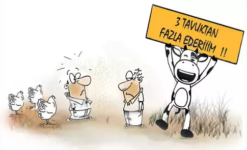

Bilindiği üzerede lidyalılardan sonra da ilk paralar devreye girmişti.

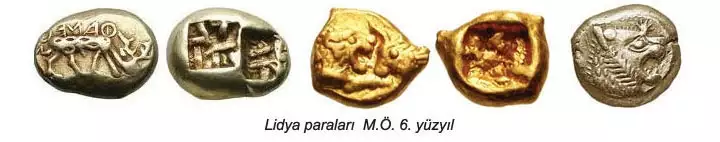

Ve yine zamanla bunun getirdiği fiziksel zorluklar nedeniyle bu
sistemden de vazgeçildi. Bunun ilk örnekleri çin hanedanları
dönemindeydi.

Özel işlemeli deri paraları takas aracı olarak kullanıyorlardı.\
 Daha sonra 13.yüzyılda kağıt uygulamaları avrupada başladı. Bunlar
senet gibi altın paraların takas kağıtlarıydı.

Osmanlı kağıt parayı 1840'da, Avrupa'dan sonra kullanmaya başladı.
“Kaime" adı verilen ilk Osmanlı kağıt para elle yapılıyordu. 1915'de
Osmanlı hükümeti parasında bazı değişiklikler yaptı ve adını “Evrak-ı
Nakdiye" olarak değiştirdi.

Ancak avrupadaki ilk formu olan kağıt paraların adı BankNote yani
bankadaki altının not kağıdı şeklindeydi. Anlamı temsili altından
ibaretti.

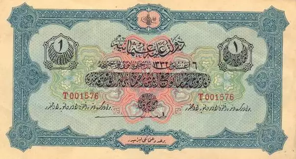

(Osmanlı Banknotlarından bir örnek)

Bir süre sonra bu gelişim devam etti. Para şekil değiştirmedi ancak
kullanım kolaylığı oluştu. Bunlar banka hesapları, kredi kartları ve
banka kartlarıydı. Telefondan bir hesaptan bir hesaba para
gönderilebiliyor ve\
 bu işlemler çift taraflı yetkili kurumlar tarafından onaylanarak işlem
tamamlanıyor. Finansal para sistemleri bugün hala bu şekilde
kullanılıyor. Gözle görülmeyen hesaplardan rakam olarak bulunan paralar
hesaptan hesaba ulaştırılıyor. Bunu bankalar ve devlet(ler) organize
ediyor. Visa, Mastercard gibi kurumlarda aynı şekilde aktarım
işlemlerini yönetiyor ve tasdik ediyor.

## Bitcoin ve Blockchain

Günün birinde Satoshi Nakamoto isminde(muhtemelen fake) bir kişi torrent
ağ yapısındaki mantığı neden finansal sistemlerde kullanmayalım diyor ve
blockchain teknolojisini bankaların ve devletlerin organize ettiği
Finansal para sistemi yerine kullanıyordu.

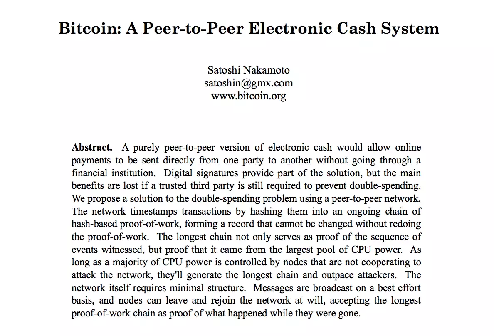
 (bitcoin.org da ilk ilan edildiğinde yazılan makale)

Bir merkez bankasına bağlı sistemler Merkezi (central)\
 Bankaların ve Merkez bankalarının olduğu sistemler Dağıtık (Decentral)\
 Bitcoin ağı gibi blockchain ağları ise dağınık - Ademi Merkeziyetçi
(ditrubuted)

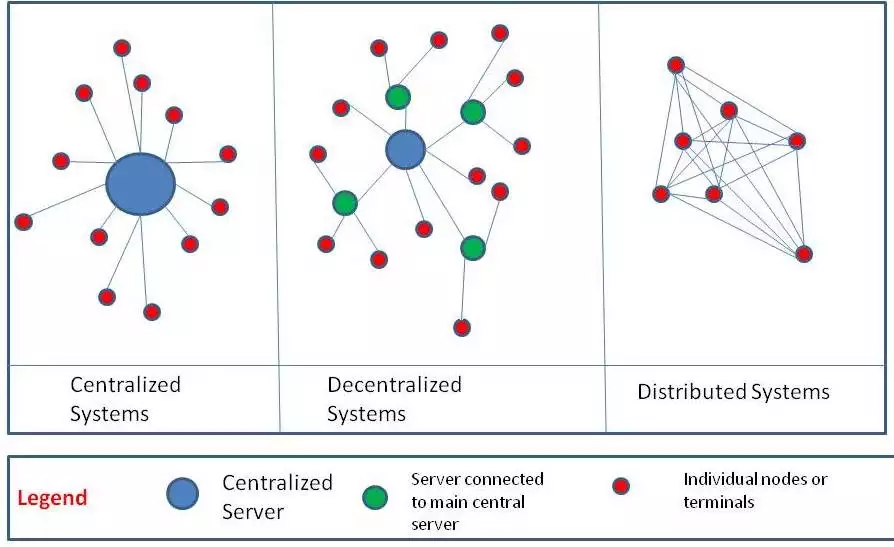

Bu ademi merkeziyetçi sistem finansal varlıklardaki güvenirliliği
bilgisayarlar ve matematiksel şifreleme ile sağlıyor. Basitçe blockchain
şu şekilde.

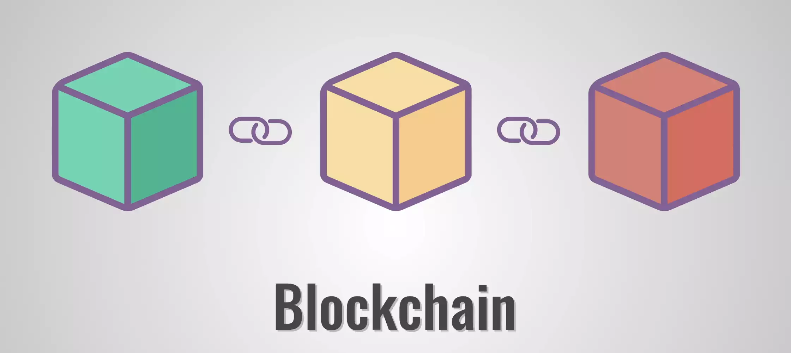

Her blok bir veri barındırıyor ve aynı zamanda kendinden önceki bloğun
parmak izini (hash) bulunduruyor. Bu şekilde birbirleri ile bağlantılı
DNA gibi sarmal bir yapısı oluyor.

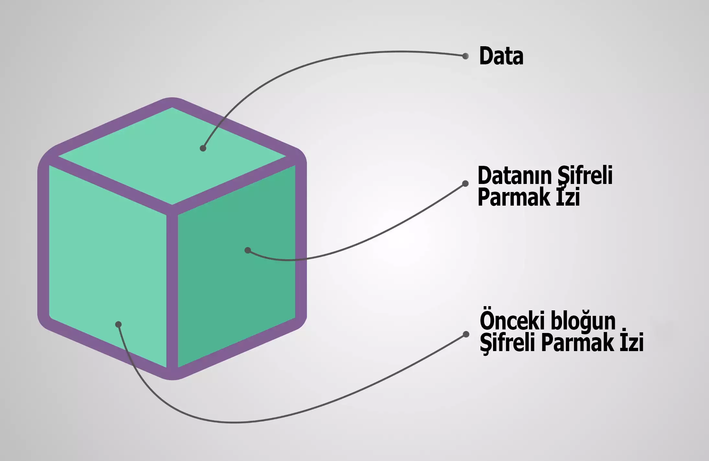

Her blok yapısı itibariyle 1 Mb yada 8 Mb gibi bir büyüklük olarak
ortaya çıkıp kendi öz datasını, bu datanın şifreli parmak izi (hash) ve
kendinden önceki blokun şifreli parmak izini taşır.

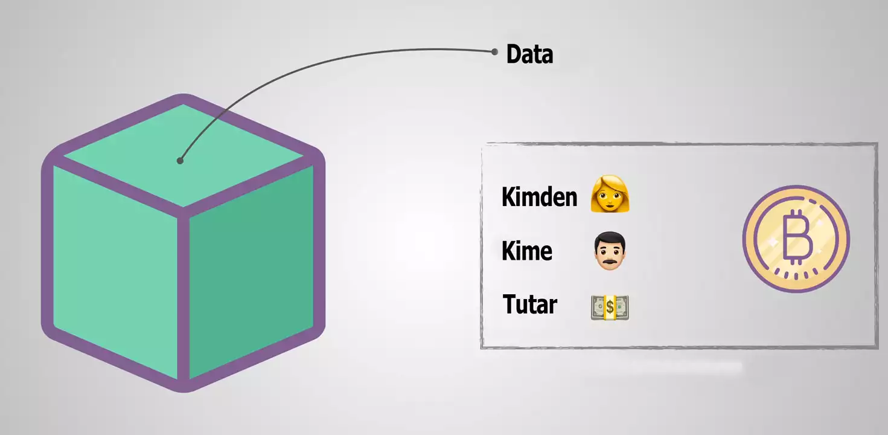

Bu data bir bitcoin bilgisini içerir. Kimden kime ne kadarlık tutarda
bir bitcoin gönderildiğini

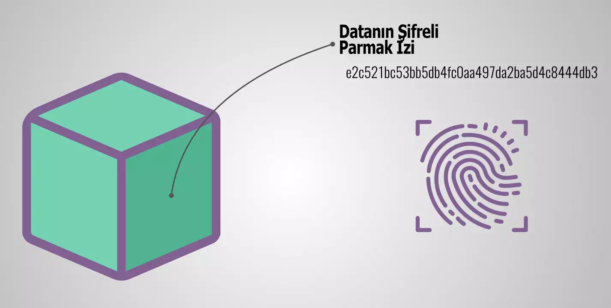

Bu verinin şifreli parmak izini ve önceki bloğun parmak izini de taşır.

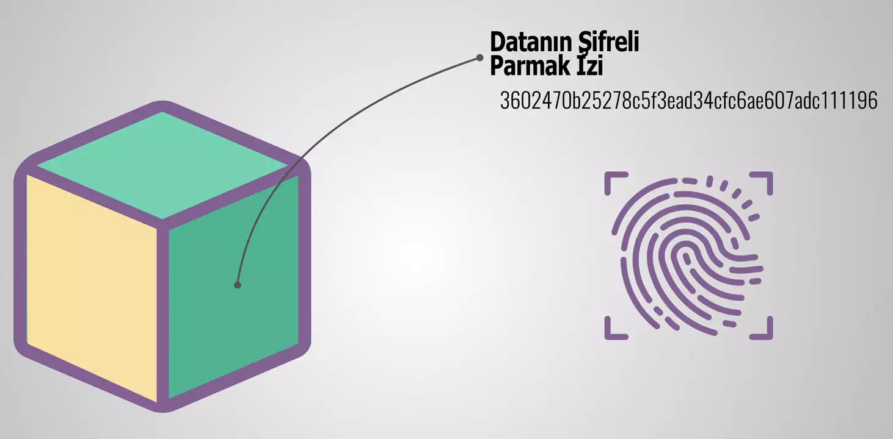

Ve yapısal anlamda şu şekilde gözükür.

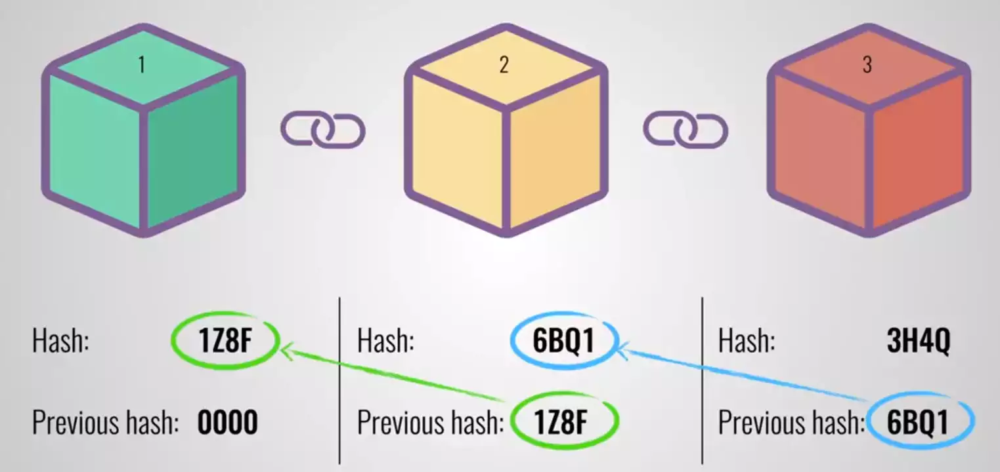

Bu yapı sahte blok yada yalan beyana müsaade etmeyen mantıksal -
matematiksel bir yapı oluşturur.

İlk blok genesis yani oluşturma bloğu olduğu için önceki blok bilgisi
yoktur.

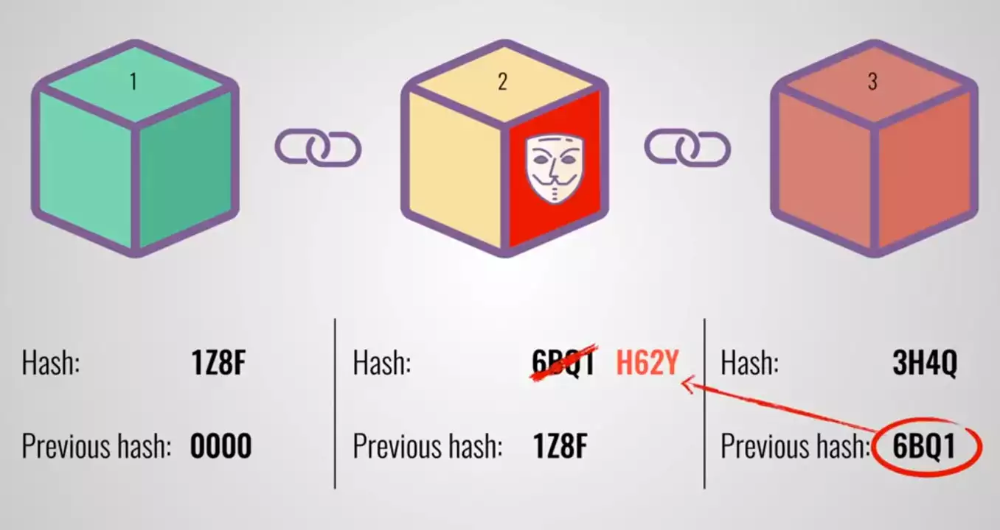

Hemen ağ tarafından sahte olan blok yalanlanır ve geçersiz sayılır.

Basitçe Blok zinciri teknolojisi (blockchain) bu şekilde çalışır.

Bazı temel prensipleri vardır bu sebeple bitcoin'in. Bir bitcoin kimden
kime gitmiş bilinir. Sırayla bloklar takip edilirse tüm işlem geçmişi
görüntülenir. Ademi merkeziyetçi olduğu için tüm işlemleri herkes tutar
ve taşır.

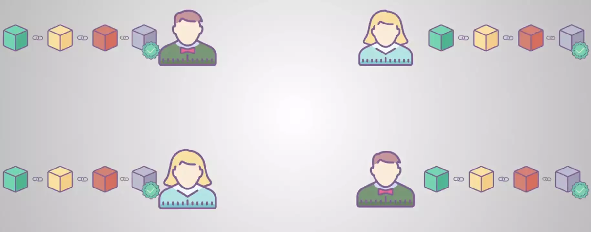

Bu sayede kripto paralar aslında son derece şeffaf bir finansal sistem
olarak çıkar karşımıza. Kriptolojisi sadece banka gibi kurumlara gerek
bırakmayan bir onay mekanizması için çalışır. Yoksa bir bitcoin ağında
kazanılan bir para elden ele nasıl geçmiş ve kullanılmış tüm ağ
kullanıcıları tarafından bilinir. Bu durum bu sistemin en şeffaf ve
güvenilir tarafıdır.

## Analiz

Şuan türkiyede birkaç kripto para borsası vardır. Bunların işlem
hacimleri şu şekildedir.

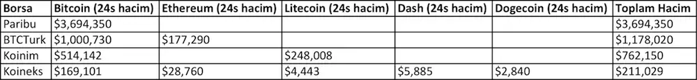
Detaylı incelemek için
[şuraya](https://webrazzi.com/2017/10/31/turkiyenin-kripto-para-borsalarinin-hacmi-ne-kadar/)
bakabilirsiniz.

Türkiyede kripto para kabul eden iş yerleri mevcuttur. Bunların
listesine de
[buradan](http://www.kriptopara.org/turkiyede-bitcoin-kabul-eden-yerlerin-listesi/)
ulaşabilirsiniz.

Özetle insanlık varlıklara değer biçmiş bu değerlere göre takas etmiş
sonra bu değerleri temsil etsin diye emtia denilen madenleri kullanmış
altın, gümüş gibi daha sonra bunları da temsilen banka notları olan
banknotları kullanmış bugüne gelmiştir. Gelecek Blokzinciri (blockchain)
teknolojisi sayesinde ademi merkeziyetçi şeffaf, izlenilebilir takip
edilebilir kripto paraların olacaktır.

Türkiye bu konuda önemli bir finans merkezi ve borsaların olduğu önemli
bir nokta olabilir. Bugün buna adım atmak geleceğin önemli bir oyuncusu
olmak anlamına gelecektir.

Çünkü 13.01.2018 itibariyle piyasada 1375 ayrı kripto para tedavülde
olup toplam piyasa değerleri 741.492.791.069 dolara tekabül etmektedir.

## Kaynak

Bazı kaynaklar incelemeniz için:

-   Sakarya Üniversitesi İslam Ekonomisi ve Finansı Araştırma Merkezi
    (İSEFAM) tarafından hazırlanan Kripto Para raporunu
    [buradan](http://www.isefam.sakarya.edu.tr/wp-content/uploads/2018/01/Kripto-Para-Birimleri-ve-f%C4%B1khi-A%C3%A7%C4%B1dan-De%C4%9Ferlendirilmesi_son.pdf)
    okuyabilirsiniz.

-   Dünyada hangi ülkelerde nasıl bir kripto para var
    [buradan](http://coinmap.org/) haritadan inceleyebilirsiniz.

-   Hangi kripto paranın pazar değeri nedir hacmi nedir incelemeniz için
    [buraya](https://coinmarketcap.com/) bakabilirsiniz.

-   Cambirdge Üniversitesi Global kripto para çalışmasını da
    [buradan](https://www.jbs.cam.ac.uk/fileadmin/user_upload/research/centres/alternative-finance/downloads/2017-global-cryptocurrency-benchmarking-study.pdf)
    okuyabilirsiniz.

-   Detaylı olarak bitcoin açılış manifestosunu
    [buradan](https://bitcoin.org/bitcoin.pdf) okuyabilirsiniz.

-   Diyagramların alındığı video
    [burada](https://www.youtube.com/watch?v=SSo_EIwHSd4&t=1s).

-   Resimlerin alındığı yazı
    [burada](http://www.kidsbank.com.tr/content20/Paranin-Hikayesi)

-   Tübitak Blokzincir teknolojisi hakkında bir bölüm kurmuş
    [buradan](http://blokzincir.tubitak.gov.tr/) ulaşabilirsiniz.