## Hızlı Kurulum

Eğer hızlıca kurmak ve adımları tek tek okumak istemiyorsanız bunun için hazırladığım scripti aşağıdaki kodları çalıştırarak indirebilir ve hızlıca otomatik bir şekilde kurabilirsiniz.

Bu scriptler buradaki [github](https://github.com/bahadirdogru/webserver-automate) sayfasında bulunmaktadır.

##### Debian 9 (stretch) & Nginx 1.14.2 (latest) & Php 7.0 & Mysql & Ajenti 1
```bash
wget https://raw.githubusercontent.com/bahadirdogru/webserver-automate/master/Install_server_debian_9-php7.0.sh | sh Install_server_debian_9-php7.0.sh
```

##### Debian 9 (stretch) & Nginx 1.14.2 (latest) & Php 7.2 & Mysql & Ajenti 1
```bash
wget https://raw.githubusercontent.com/bahadirdogru/webserver-automate/master/debian9-nginx-php7.2-mysql8-ajenti.sh | sh debian9-nginx-php7.2-mysql8-ajenti.sh
```

##### Debian 9 (stretch) & Nginx 1.14.2 (latest) & Php 7.4 & MariaDb 15 & Ajenti 1
```bash
wget https://raw.githubusercontent.com/bahadirdogru/webserver-automate/master/debian9-php7.4-nginx-mariadb-ajenti.sh |sh debian9-php7.4-nginx-mariadb-ajenti.sh
```

##### Debian 10 (buster) & Nginx 1.14.2 (latest) & Php 7.4 & MariaDb 15 & Ajenti 1
```bash
wget https://raw.githubusercontent.com/bahadirdogru/webserver-automate/master/debian10-php7.4-nginx-mariadb-ajenti.sh | sh debian10-php7.4-nginx-mariadb-ajenti.sh
```

## Debian

Debian Projesi, özgür bir işletim sistemi yapmaya karar vermiş gönüllülerin oluşturduğu bir işletim sistemidir. Bu işletim sistemine biz Debian GNU/Linux veya kısaca Debian diyoruz. İşletim sistemi; bilgisayarınızın, programları ve uygulamaları çalıştırmasını sağlar. Dünyadaki en popüler işletim sistemlerinden birisidir. Ubuntu gibi diğer popüler işletim sistemleri Debian baz alınarak geliştirilmiştir. Detaylı bilgi [debian.org](https://www.debian.org/intro/about.tr.html)

## Nginx

Nginx aslen mail.ru isimli rus mail sunucusu sitesi için Rus yazılım mühendisi Igor Sysoev tarafından geliştirilerek başlanmış hafif, stabil, hızlı bir mail istemcisi projesidir. Daha sonraları geliştirilerek tüm sunucular için uygun hale getirilen bir web sunucusudur. Apacheden % 400 daha iyi performans sergilediği testlerde tespit edilmiştir. 

Nginx özellikle yüksek trafikli ve yoğun istek girişi olan web siteleri için çok uygundur. Single Thread yanıt yapısıyla sayfayı tek seferde indirip, sayfa açılma hızında farkedilir büyük bir artış sağlar. Nginx apache ve litespeed ile karşılaştırıldığında çok daha az cpu kullanır. Bu sebeple Nginx sanal sunucular(VPS) için çok iyi bir seçimdir. Detaylı bilgi [nginx.com](https://www.nginx.com/careers/#history-nginx)

## Ajenti

Ajenti, çeşitli sunucu yönetimi görevleri için kullanılabilen, Linux Debian, Ubuntu, CentOS, RHEL, FreeBSD işletim sistemlerinde ve Raspberry Pi için bile optimize edilmiş Raspbian işletim sisteminde kullanılabilen Türkçe desteği bulunan, Python ile yazılmış açık kaynak (open source), web tabanlı sunucu kontrol panelidir.

Ajenti Panel ile birlikte sunucunuzadaki paketleri yönetebilir, yeni paket kurabilir, komutları çalıştırabilir ve kullanımdaki RAM, boş disk alanı vb. gibi temel sunucu bilgilerini görüntüleyebilirsiniz. Bu işlemlerin tümüne bir web tarayıcısından Ajenti Admin Paneline erişirek yapabilirsiniz. Ajenti V adlı bir eklenti paketiyle aynı kontrol panelinden birden çok web sitesini yönetebilirsiniz. Biz Ajeti paneli kurup üzerine Ajenti V (Virtual Host) modülünü kuracağız.
Ajenti hakkında detaylı bilgi: [ajenti.org](https://ajenti.org/)

## Kurulum

Debian 10 üzerinden anlatacağım bu adımlar takip edilerek yönetilebilir web sunucusu kurabilirsiniz.

Temiz bir Debian 10 kurulumunun ardından aşağıdaki komut ile temizlik yapıyoruz.

```bash
sudo apt-get -y remove --purge exim4*; 
sudo apt-get -y remove --purge postfix*; 
sudo apt-get -y autoremove;
sudo apt-get -y autoclean;
```

Standart portları kullanmak iyi değil o sebeple genelde port numaralarını değiştirmek iyi oluyor. Eğer ssh_key kullanmıyorsanız muhakkak ssh portunu değiştirin.

```bash
sudo sed -i 's/#Port 22/Port 22222/g' /etc/ssh/sshd_config;
```

ssh portu 22 yerine 22222 ye dönüşmüş oldu.

Özellikle sanal sunucularda ram az olabiliyor bu durumda disk içinden bir kısım alanı ram alanı olarak kullanabiliyoruz. Buna Swap deniyor. Bizde sunucumuzda ne olur ne olmaz diye bir miktar Swap kuralım.

```bash
sudo fallocate -l  2G /swapfile;
sudo chmod 600 /swapfile;
sudo mkswap /swapfile;
sudo swapon /swapfile;
sudo echo /swapfile none swap sw 0 0 >> /etc/fstab;
sudo sysctl vm.swappiness=10;
sudo sysctl vm.vfs_cache_pressure=50;
sudo echo vm.swappiness = 10 >>/etc/sysctl.conf;
sudo echo vm.vfs_cache_pressure = 50 >>/etc/sysctl.conf;
```

2 GB swap tanımlaması yaptım ancak siz daha az yada daha fazla sunucunuzun durumuna göre tanımlayabilirsiniz.

Debian(stable) son sürüm php paketlerini kendi depolarında sunmaz. Bu sebeple sury.org üzerinde debian için güncel php paketlerini temin etmek için ayar yapıyoruz.

```bash
cd /tmp || exit;
sudo apt install ca-certificates apt-transport-https;
wget -q https://packages.sury.org/php/apt.gpg -O- | sudo apt-key add -;
sudo echo "deb https://packages.sury.org/php/ buster main" | sudo tee /etc/apt/sources.list.d/php.list;
rm apt.gpg;
```

Aynı sebepten nginx paketlerinin güncel depolarını tanımlıyoruz.

```bash
wget https://nginx.org/keys/nginx_signing.key;
sudo apt-key add nginx_signing.key;
sudo echo deb http://nginx.org/packages/debian/ buster nginx >> /etc/apt/sources.list;
sudo echo deb-src http://nginx.org/packages/debian/ buster nginx >> /etc/apt/sources.list;
```

En güncel MariaDB deposu için https://downloads.mariadb.org/mariadb/repositories adresinden bilgileri alıp depo ayarlarını yapıyoruz.

```bash
sudo apt-get install software-properties-common dirmngr
sudo apt-key adv --fetch-keys 'https://mariadb.org/mariadb_release_signing_key.asc'
sudo add-apt-repository 'deb [arch=amd64,arm64,ppc64el] http://ams2.mirrors.digitalocean.com/mariadb/repo/10.5/debian buster main'
```

Artık tüm depo ayarlarını yaptığımıza göre depodaki paket bilgilerini sistemimize çekerek yavaştan indirmeye geçebiliriz.

```bash
sudo apt-get -y autoremove;
sudo apt-get -y autoclean;
sudo apt-get -y update;
sudo apt-get -y upgrade;
```

Debian 10 da Ajenti için gerekli bir python paketinin kurulamadığını fark ettim bu eksikliği gidermek için aşağıdaki kodu çalıştırın.

```bash
sudo apt-get install python-pil
wget http://ftp.br.debian.org/debian/pool/main/p/pillow/python-imaging_4.0.0-4+deb9u1_all.deb
sudo dpkg -i dpkg -i python-imaging_4.0.0-4+deb9u1_all.deb
```

Şimdi gerekli tüm paketleri kuralım:

```bash
sudo apt-get -y install nginx unzip zip fail2ban php7.4 php7.4-fpm php7.4-mbstring php7.4-curl php7.4-gd php7.4-mysql php7.4-soap php7.4-xml php7.4-json php7.4-zip php7.4-cli php7.4-opcache php7.4-common php7.4-readline mariadb-server redis-server memcached php-redis php-memcached;
```

Ajenti panel ve Ajenti V (Virtual Host) kurulumu için gerekli komutlar:

```bash
wget -O- https://raw.github.com/ajenti/ajenti/1.x/scripts/install-debian.sh | sh;
sudo apt-get -y install ajenti-v ajenti-v-mysql ajenti-v-php7.4-fpm ajenti-v-ftp-pureftpd ajenti-v-nginx;
```

Php paket yöneticisi Composer'ı kuralım:
```bash
curl -sS https://getcomposer.org/installer | php;
sudo mv composer.phar /usr/local/bin/composer;
composer self-update;
```

Fail2ban paketi şifre deneyerek yapılan saldırıları anlamaya ve bu saldırıları yapan ip adreslerini otomatik olarak engelleyen bir uygulama. Bunu güvenliğimiz için kuralım ve ayarlayalım.

```bash
cp /etc/fail2ban/jail.conf /etc/fail2ban/jail.local;
sudo sed -i 's/# bantime = 3600/bantime = 3600/g' /etc/fail2ban/jail.local;
```

Ajentinin Access-Control-Max-Age isimli parametre ayarlarında python dosyasında bir hata var bunu otomatik düzeltmek için aşağıdaki kodu yazınız.

```bash
sudo sed -i 's/("Access-Control-Max-Age", 3600)/("Access-Control-Max-Age", "7200")/g' /usr/share/pyshared/socketio/transports.py;
sudo sed -i 's/("Access-Control-Max-Age", 3600)/("Access-Control-Max-Age", "7200")/g' /usr/share/pyshared/socketio/handler.py;
```

Şimdi sırada kurduğumuz mysql(MariaDB) için ayarları girmek ve şifreleri belirlemek kaldı.

```bash
sudo mysql_secure_installation
```

Burada sunucu kurulumu tamamlanmış oldu.

Şimdi:

- Ajenti adresiniz https://ipadress:8000 oldu.
- SSH portunuz 22222 oldu.
- 2GB Swap alanı ayarlandı.
- Php 7.4 sürümü ve MariaDB 15 sürümü Ajenti V ile birlikte kuruldu.

Sırada sunucuyu yeniden başlatmak var.

```bash
sudo reboot
```

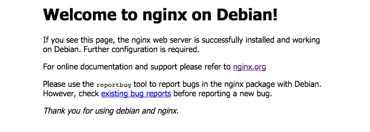
Tebrikler artık debian üzerinde çalışan bir nginx sunucunuz var.

Ajenti Panele ilk girişte kendinden imzalı ssl ile gelir o sebeple onay vererek giriş yaparız.
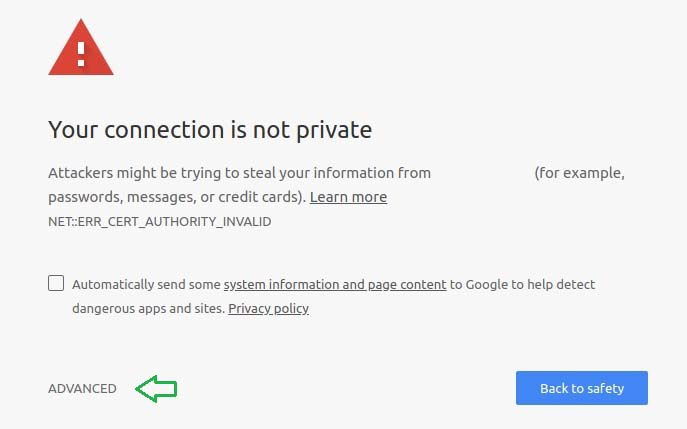
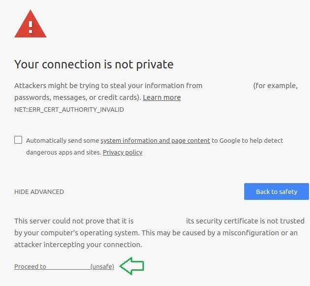

Ajenti Panelin ilk giriş kullanıcı adı root ilk şifresi ise admin olarak gelir.


Panel üzerinden gerekli ayarları yapabiliriz.
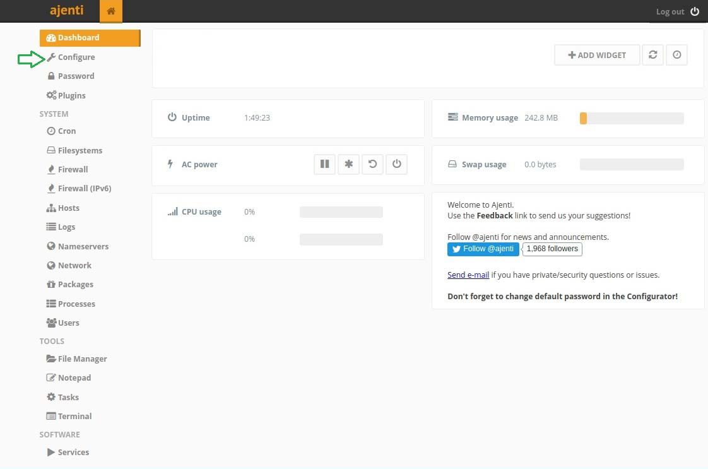

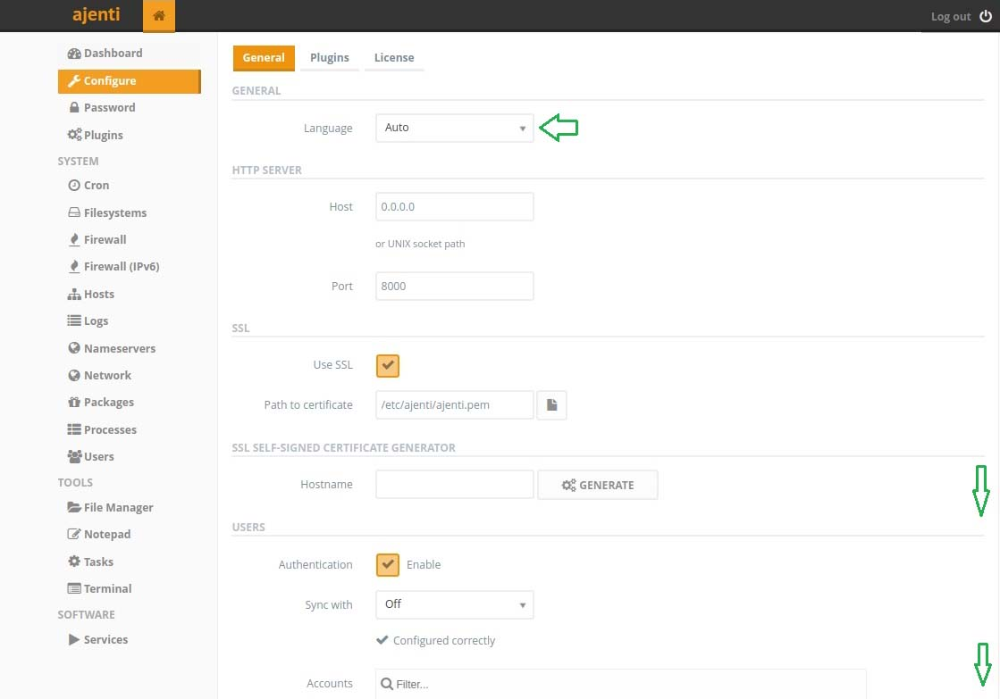

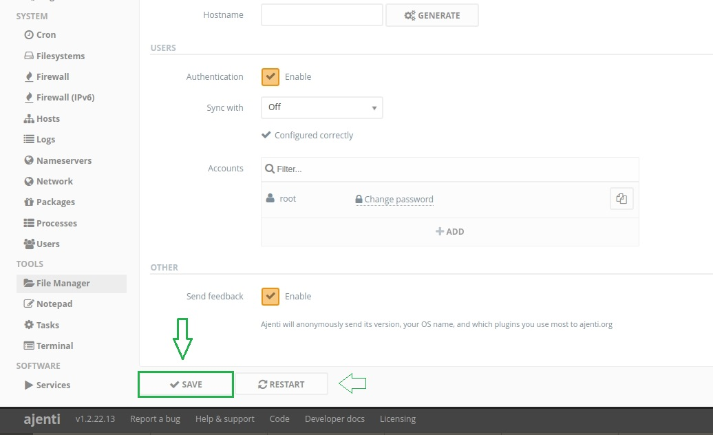

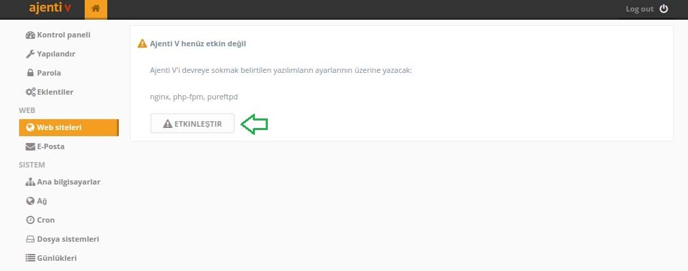

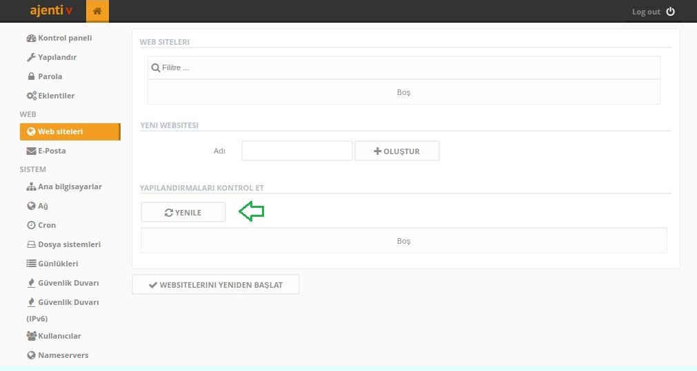

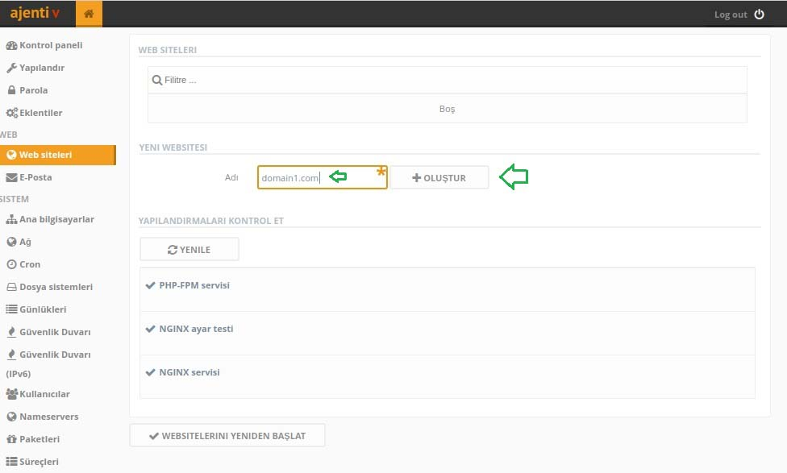

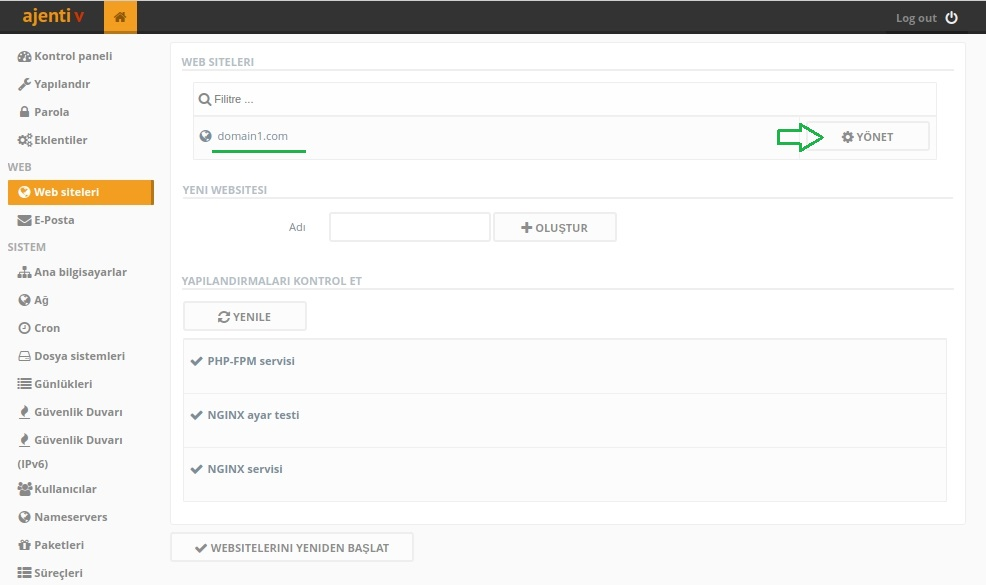

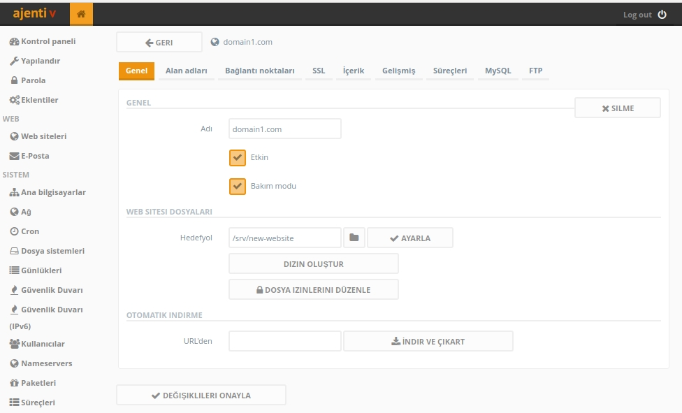

Buraya kadar okuduyup uyguladıysanız umarım faydalı olmuştur. Bir sorunuz varsa bana iletişim formundan sorabilirsiniz.

Eğer SSL kurulumunu da yapmak istiyorsanız [Lets Encrypt ile SSL kurulumu](/letsencrypt-ile-ssl-kurulumu) yazımı okuyabilirsiniz.