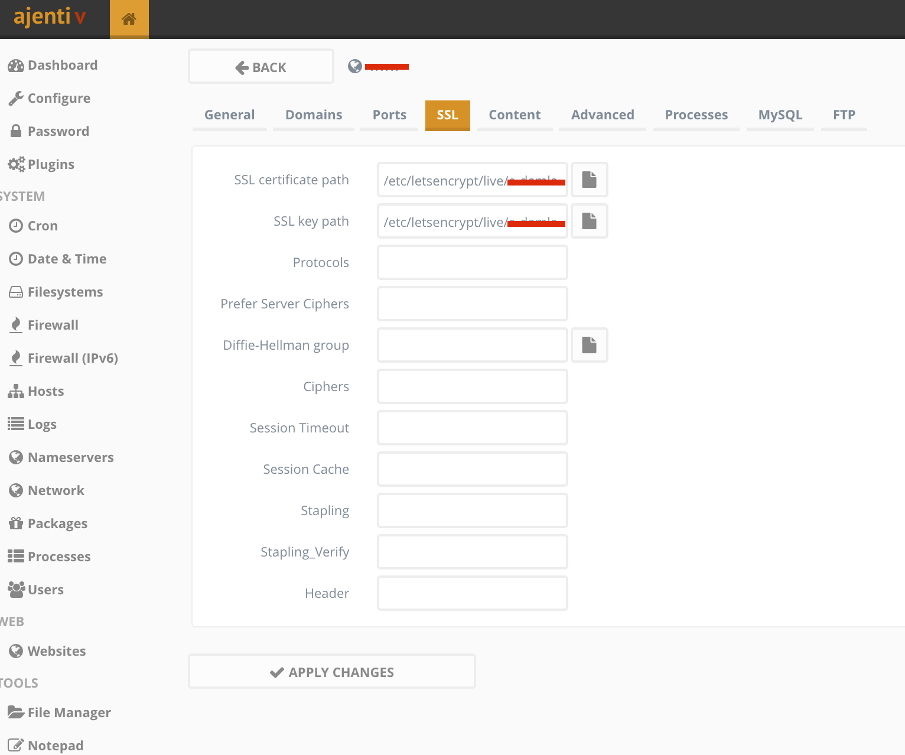
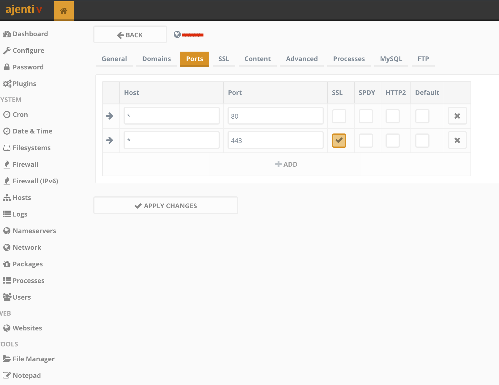

## SSL

SSL (Secure Socket Layer) Güvenli Giriş Katmanı‘dır.
Tarayıcı ile sunucu arasındaki trafiğin şifrelenerek aradaki tüm aktarıcılardan içeriği korur.
Mesela: Google'a bir kelime yazıp arayınca bu kelimeyi sadece siz ve google sunucuları bilir.
Hizmet aldığınız internet şirketleri bilemez. (Bununla alakalı olarak elbette hack yöntemleri de vardır.)

## SSL Nasıl Çalışır / Sertifika Kurulumu

SSL Public Key ve Private Key ile kurulur.
Private sadece sunucuda güvenle tutulurken public key tarayıcılara gönderilir.

## SSL Issuer / Sertifika Otoriteleri

Bu SSL sertifikalarını bir otorite tarafından onaylanır. Bu yöntem ile sunucudaki güvence sağlanır.

Bunlardan popüler olanlar: Comodo SSL, Rapid SSL, Thawte, Symantec, Certum

İşte Internet Security Research Group(İnternet Güvenlik Araştırmaları Grubu) tarafından yönetilen ve Linux vakfı tarafından da desteklenen "Lets Encrypt" bu hizmeti ücretsiz sağlayan aracıdır. İnternette güvenliliği ve gizliliği sağlamaktır.

## Kurulum

Buradan itibaren Debian10 üzerine Ajenti Web panel ile kurduğumumuz sunuculara bu sertifika nasıl yüklenir onu anlatacağım. Eğer bu sunucularun nasıl kurulacağını merak ediyorsanız [Debian ve Nginx ile Sunucu Kurulumu](/debian-ve-nginx-ile-webserver-kurulumu) adlı yazımı okuyabilirisiniz.

İlk önce gerekli paketleri yükleyebilmek için paket bilgilerini güncelliyoruz ve ardından kuruyoruz.

```bash
sudo apt update;
sudo apt upgrade;
sudo apt install certbot python3-certbot-nginx;

```

Biz nginx ayarlarımızı ajenti panel üzerinden yaptığımız için certbot üzerinden direkt nginx ayarlarına müdahale ettirmeyeceğiz. Sadece sertifikaları almasını "certonly" diyerek belirteceğiz.

```bash
sudo certbot certonly --nginx -d example.com -d www.example.com
sudo certbot renew --dry-run
```

Bu komutun ardından gelen sorulara cevap vererek ssl sertifikasını onaylatmış oluyoruz.
Sertifikamız /etc/letsencrypt/live/siteadi.com/ altında bulunacaktır.

Bu dizindeki fullchain.pem ve privkey.pem dosyalarını ajenti panelin altında resimdeki yerde ayarlıyoruz.



Ardından artık ssl olduğu için 443 numaralı portu ayarlıyoruz.

